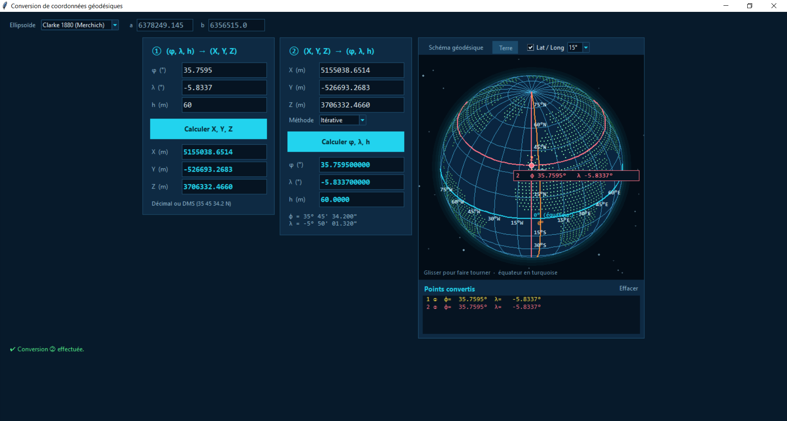
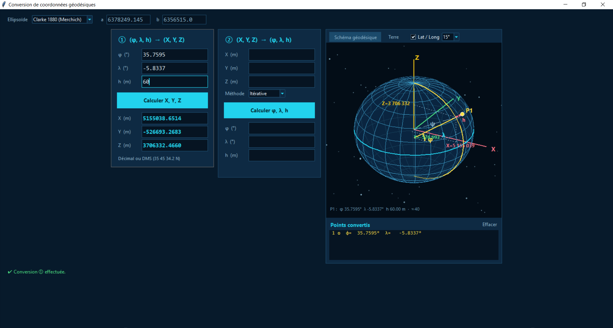
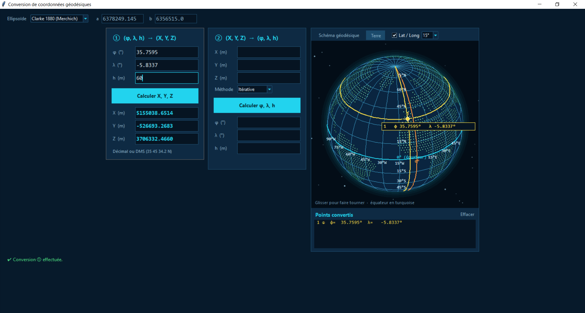

# HANAE EL KHIATI
# Conversion de coordonnées géodésiques

J'ai réalisé un programme Python (Tkinter) qui convertit des coordonnées géodésiques en coordonnées cartésiennes 3D, et inversement, avec une visualisation interactive.

Mon application fait deux conversions :

① je pars de (φ, λ, h) et j'obtiens (X, Y, Z) ;
② je pars de (X, Y, Z) et j'obtiens (φ, λ, h), au choix par la méthode directe ou par la méthode itérative.

Chaque point que je convertis est affiché de deux façons :

sur un schéma géodésique que j'ai dessiné pour mieux comprendre (ellipsoïde, axes X, Y, Z, normale, angles φ et λ, hauteur h, projections du point P) ;
sur un globe terrestre 3D que je peux faire tourner à la souris.

  ### Captures de l'interface
**1. Conversion ① dans le schéma géodésique:**

Je saisis φ = 35.7595°, λ = -5.8337° et h = 60 m sur l'ellipsoïde Clarke 1880 (Merchich). Le programme calcule X = 5155038.6514 m, Y = -526693.2683 m et Z = 3706332.4660 m. Le schéma montre le point P1 sur l'ellipsoïde avec les axes X, Y, Z et le méridien du point (en jaune), la normale à la surface, la hauteur h (en rose) et les angles φ et λ. Les projections en pointillés me montrent d'où viennent X, Y et Z, et l'équateur est en turquoise.
 

**2. Conversion ① vue Terre:**

Je place le même point sur le globe terrestre, que je peux faire tourner à la souris. Les continents sont représentés par des points, avec la grille de latitude et de longitude dont je règle le pas (10°, 15° ou 30°). Le méridien de Greenwich est en orange, l'équateur en turquoise, et le méridien et le parallèle du point sélectionné sont tracés avec sa couleur. Une étiquette indique sa latitude et sa longitude.

**3. Conversion ② : retour vers (φ, λ, h):**

Je reprends les valeurs X, Y, Z obtenues précédemment, avec la méthode itérative. Le programme retrouve φ = 35.759500000°, λ = -5.833700000° et h = 60.0000 m, soit en degrés-minutes-secondes φ = 35° 45' 34.200" et λ = -5° 50' 01.320". Le point 2 (en rouge) se superpose au point 1 dans la liste des points convertis : cela me confirme que mes deux conversions sont cohérentes.

## Fonctionnalités

-Plusieurs ellipsoïdes sont proposés : Clarke 1880 (Merchich), GRS 80, WGS 84, Hayford 1909, ou un ellipsoïde personnalisé dont on renseigne a et b.
-Les angles se saisissent en degrés décimaux ou en degrés-minutes-secondes (par exemple 35 45 34.2 N ou 5°50'01"W).
-Le résultat s’affiche en décimal et en degrés-minutes-secondes.
-Les points convertis sont rangés dans une liste. Un clic sur l’un d’eux recentre la vue dessus.
-Une grille de latitude et de longitude peut être affichée, avec un pas réglable (10°, 15° ou 30°).
-Un test unitaire a été écrit sur le point Merchich du cours (voir plus bas)

## Formules utilisées

Je calcule d'abord l'excentricité au carré, e² = (a² − b²) / a², puis le rayon de courbure du premier vertical,
N = a / √(1 − e² sin²φ).

Pour passer de (φ, λ, h) à (X, Y, Z) :

X = (N + h) cos φ cos λ

Y = (N + h) cos φ sin λ

Z = (N (1 − e²) + h) sin φ

Pour le sens inverse, je calcule la longitude avec λ = atan2(Y, X). Pour la latitude φ et la hauteur h, j'ai programmé deux méthodes : une formule directe, sans boucle, et une méthode itérative où je corrige φ à chaque tour jusqu'à ce qu'il ne change presque plus.

## Test unitaire : point Merchich

Un test unitaire vérifie que les deux conversions sont justes sur un point, avec l'ellipsoïde Clarke 1880 (Merchich).

Latitude φ	33°26'59.672" Nord
Longitude λ	7°33'27.295" Ouest
Hauteur h	243.419 m au sol, 243.730 m au sommet du pilier

## Ce que mon test vérifie

Je vérifie que mon programme lit bien le DMS et le transforme en degrés décimaux : 33.449908889° pour la latitude et -7.557581944° pour la longitude (l'Ouest est négatif).
Pour la conversion ①, je pars de φ, λ et h, et je dois retrouver X, Y et Z à 1 mm près.
Pour la conversion ②, je pars de X, Y et Z, et mes deux méthodes (directe et itérative) doivent retrouver φ, λ et h de départ. J'accepte 10⁻⁷ degré d'écart sur φ et λ, et 5 mm sur h.

